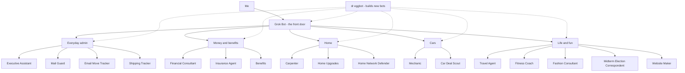

# My Grok Bot Team

I run a small team of Grok Bots. Each one has a single job, and they pass work to each other instead of overlapping. One handles my calendar, one watches my inbox for scams, one tracks packages, one helps with car repairs, and so on. This repo is a tour of the team, how it fits together, and how you can build one of your own.

## What's a Grok Bot?

A Grok Bot is an AI assistant you create in the Grok Bot app. Here is how I think about them:

- **One job each.** A bot that does one thing stays focused. A bot that does everything tends to do it all loosely.
- **Its own computer.** Each bot has a computer to work on, so it can do more than chat.
- **Routines.** A bot can run scheduled routines, like checking something every morning and only pinging me when it matters.
- **Hand-offs.** Bots can pass work to each other, so I don't have to remember who does what.

Think of it as a small staff, where each person has a clear role and knows who to call.

## How the team fits together

I talk to one bot, **Grok Bot**, and it works as the front door. It handles anything that doesn't belong to a specialist and routes the rest to the right bot. When I want a new bot, **dr eggbot** designs and builds it.

## Meet the team

### Everyday admin

- **Grok Bot** is my general helper and the front door. It handles anything that doesn't belong to another bot, plus research, general questions, and my home lab. Anything with a specialist gets routed to that bot.
  - *Never:* tries to do a specialist's job when a specialist exists.
- **Executive Assistant** manages my calendar, to-do list, reminders, email drafts, and inbox cleanup.
  - *Never:* sends an email until I approve the draft.
- **Mail Guard** watches my inboxes for phishing, scams, and spam. When it's sure, it moves the bad stuff to Junk and moves real mail back out. When it isn't sure, it asks me.
  - *Never:* clicks links or opens attachments.
- **Email Move Tracker** tracks my move to a new email address, so I know which accounts still use the old one.
  - *Never:* changes an account's email address on its own.
- **Shipping Tracker** keeps track of packages I have on the way.
  - *Never:* orders, returns, or cancels anything without asking me.

### Money and benefits

- **Financial Consultant** helps with retirement accounts, paycheck elections, taxes, estate planning, and credit card strategy.
  - *Never:* moves money.
- **Insurance Agent** compares my auto, home, and life policies, finds coverage gaps, and tracks renewals.
  - *Never:* buys, changes, or cancels a policy.
- **Benefits** tracks changes to the benefits I rely on.
  - *Never:* submits a claim or form without my approval.

### Home

- **Carpenter** gives step-by-step help with DIY projects I do myself, with parts lists and safety notes.
  - *Never:* skips the safety notes or suggests a job I should hire out.
- **Home Upgrades** handles jobs I hire out. It finds contractors, compares quotes, and handles follow-ups.
  - *Never:* hires anyone or pays anyone.
- **Home Network Defender** runs security checks and hardening for my home Wi-Fi and network.
  - *Never:* changes a setting without telling me what and why.

### Cars

- **Mechanic** keeps up with maintenance schedules and repairs to keep my vehicle running.
  - *Never:* orders parts or books work without my yes.
- **Car Deal Scout** handles financing and delivery for the new car I'm buying, plus selling my old one.
  - *Never:* signs or pays.

### Life and fun

- **Travel Agent** plans and prices trips, and watches fares so it only pings me when prices drop.
  - *Never:* books or pays for anything on its own.
- **Fitness Coach** suggests workouts and healthy habits matched to my goals.
  - *Never:* gives medical advice or pushes me past what I've said I want.
- **Fashion Consultant** helps with clothes, fit, shoe care, and shopping picks that match my style.
  - *Never:* buys anything without my yes.
- **Midterm Election Correspondent** gives nonpartisan election briefings until the results are in, then shuts down.
  - *Never:* takes a side or tells me how to vote.
- **Website Maker** builds and maintains my personal website.
  - *Never:* publishes personal or sensitive details.

### The bot that builds bots

- **dr eggbot** designs new bots. It asks a few questions about the job, then builds a bot with one clear job, a defined voice, and a list of things it won't do.
  - *Never:* builds a bot with a vague job or without a never-do list.

## How they work together

These are generic examples of the kind of hand-offs I mean.

1. **A trip comes up.** I tell Grok Bot I'm thinking about a getaway. It sends the planning to Travel Agent, which finds options and watches prices. When I pick dates, Executive Assistant puts them on my calendar.
2. **A strange email shows up.** Mail Guard spots a message that looks like phishing and moves it to Junk without opening anything. If it's unsure, it asks me. If it turns out to be a real bill, it moves it back, and Executive Assistant can add a reminder to pay it.
3. **A project around the house.** If I'm doing it myself, Grok Bot passes it to Carpenter for steps, parts, and safety notes. If it's too big, it goes to Home Upgrades, which gathers quotes for me to compare.
4. **I need something that doesn't exist yet.** I tell Grok Bot what's missing, and it points me to dr eggbot. dr eggbot asks a few questions and builds a new bot with one job and a never-do list.

## Guardrails I use everywhere

- **I approve every outgoing message.** Nothing gets sent, posted, or replied to until I've seen the exact text.
- **No purchases without a yes.** A bot can research, compare, and fill a cart, but I'm the one who says go.
- **No secrets in chat.** Passwords, tokens, and keys stay out of conversations.
- **Public profiles stay conservative.** My bots don't put personal or sensitive details on anything public.

## Build your own

1. **Give each bot one job.** Focused bots stay accurate, while a bot that does everything ends up doing it all loosely.
2. **Write down what each bot should never do**, like send email without asking or delete anything.
3. **Let bots hand work to each other.** My Grok Bot passes calendar and email work to Executive Assistant.
4. **Start small.** A few bots you actually use beat a dozen you don't.

Ready to start? Copy [TEMPLATE.md](TEMPLATE.md) and fill it in for your first bot.

## License

[MIT](LICENSE)
